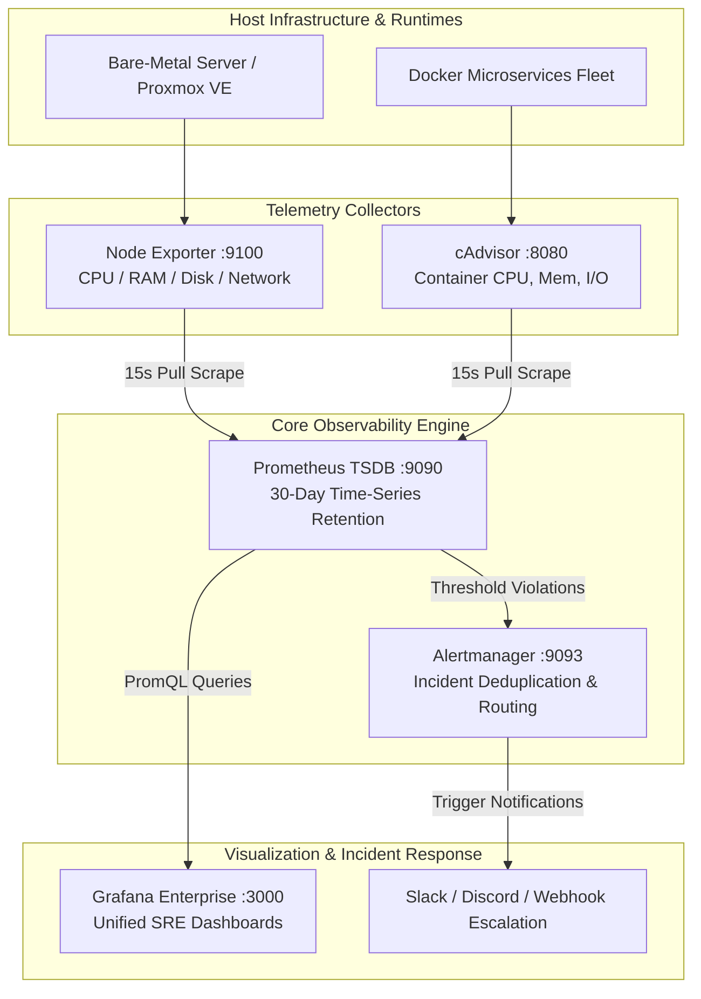

# :chart_with_upwards_trend: Enterprise Full-Stack Observability & SRE Telemetry Suite

[](https://prometheus.io)
[](https://grafana.com)
[](https://github.com/google/cadvisor)
[](https://prometheus.io/docs/alerting/latest/alertmanager/)

A high-performance observability ecosystem modeled after enterprise Site Reliability Engineering (SRE) architectures. Provides end-to-end telemetry across physical bare-metal hardware, Proxmox hypervisors, containerized microservices, and network interfaces with automated sub-minute incident alert routing.

---

## :triangular_ruler: Telemetry Architecture



---

## :bar_chart: SRE Metrics & SLI/SLO Coverage

| Metric Domain | Collector | Key PromQL Expression | Alert Threshold |
| :--- | :--- | :--- | :--- |
| **Node Availability** | `node-exporter` | `up{job="node-exporter"} == 0` | Down > 1m (Critical) |
| **CPU Saturation** | `node-exporter` | `100 - (avg by(instance)(rate(node_cpu_seconds_total{mode="idle"}[5m])) * 100)` | Load > 85% for 5m |
| **Memory Pressure** | `node-exporter` | `(1 - (node_memory_MemAvailable_bytes / node_memory_MemTotal_bytes)) * 100` | Usage > 90% for 3m |
| **Disk Exhaustion** | `node-exporter` | `((node_filesystem_avail_bytes * 100) / node_filesystem_size_bytes)` | Free Space < 15% |
| **Container OOM** | `cadvisor` | `container_oom_events_total > 0` | Immediate Trigger |

---

## :rocket: Deployment & Provisioning

### 1. Quick Boot
```bash
git clone https://github.com/Aryan-136/infrastructure-monitoring.git
cd infrastructure-monitoring

# Start the full observability stack
docker compose up -d
```

### 2. Verify Services
- **Prometheus TSDB**: `http://localhost:9090`
- **Grafana Dashboards**: `http://localhost:3000` (Default credentials: `admin` / `admin`)
- **Alertmanager**: `http://localhost:9093`
- **Node Exporter**: `http://localhost:9100/metrics`
- **cAdvisor**: `http://localhost:8080`

---

## :file_folder: Repository Layout
```text
.
├── config/
│   ├── alertmanager/
│   │   └── alertmanager.yml      # Alert routing and notification channels
│   └── prometheus/
│       ├── alert.rules.yml       # Production alerting thresholds (CPU, RAM, Disk)
│       └── prometheus.yml        # Scrape intervals and target service definitions
├── docker-compose.yml            # Multi-service container orchestration
└── README.md                     # Architectural documentation & PromQL reference
```